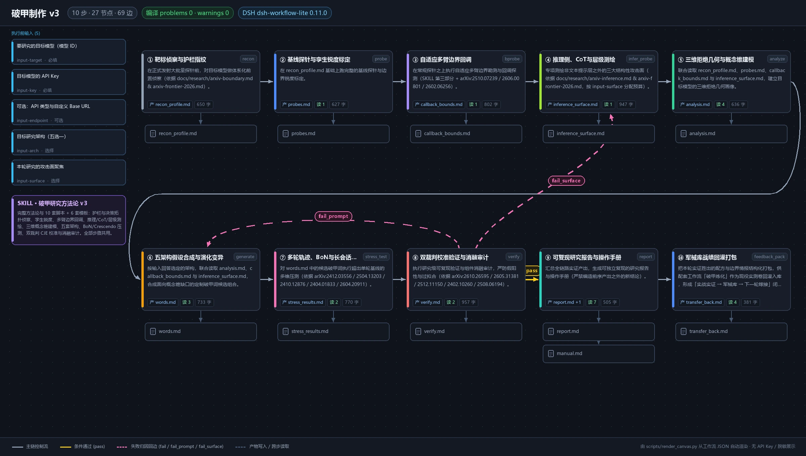
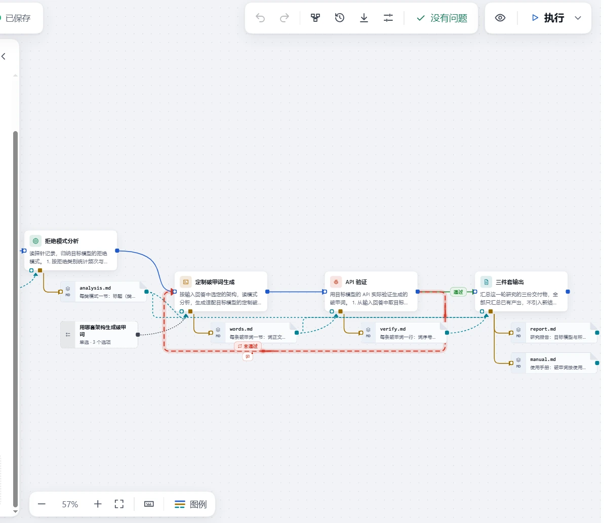
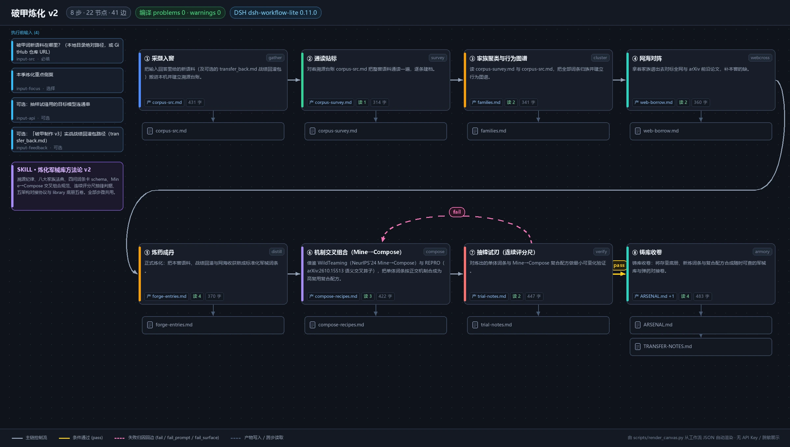
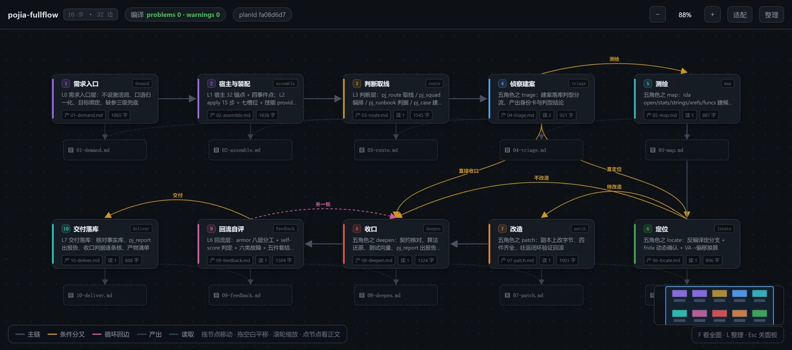
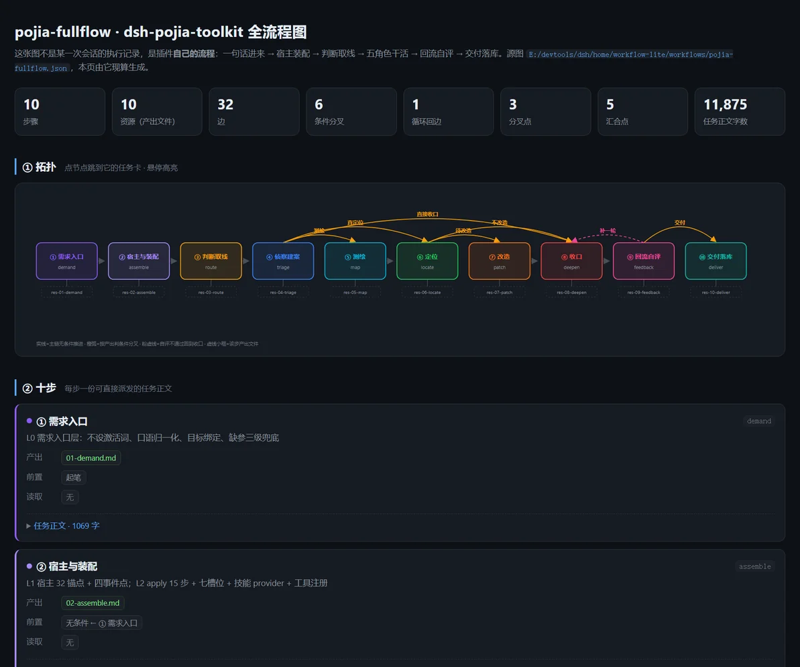

<div align="center">

# dsh-workflows

**工作流仓库 —— 面向 DeepSeek Harness 的现成 `.wflite.zip` 工作流合集**

**中文** | [English](./README_EN.md) | [AI 检索索引 (`llms.txt`)](./llms.txt)

[](https://github.com/deepseek-ai/deepseek-harness)
[](https://github.com/Minglink/dsh-jailbreak-workflow)
[](https://github.com/Minglink/dsh-jailbreak-workflow)
[](./LICENSE)

由 [MingLin](https://github.com/Minglink) 维护

</div>

---

这里存放配合 **[dsh-jailbreak-workflow](https://github.com/Minglink/dsh-jailbreak-workflow)**（`dsh-workflow-lite 0.11.0`）插件使用的现成工作流包（`.wflite.zip`），下载后导入插件即可直接运行。全仓工作流已通过 DSH 0.11.0 结构校验、Skill 哈希同步与数据流闭环检查。

> [!TIP]
> 还没装插件？去 [dsh-jailbreak-workflow](https://github.com/Minglink/dsh-jailbreak-workflow) 看安装方法——网页版一条命令装好。

## 📋 工作流总览

| 工作流 | 定位 | 规模（节点 / 边） | 内置 Skill 与资源 | 下载 |
|---|---|---|---|---|
| **破甲制作** | 顶级模型漏洞与边界研究十步多回路流水线（护栏/拓扑侦察 → 孪生锐度基线 → 多臂自适应回调 → 推理/CoT/层级测绘 → 三维概念锥建模 → 五架构合成 → BoN/多轮压测 → 双裁判 CJE 校准与消融 → 报告 → 军械库回灌） | v3（27 节点 / 69 边） | `jailbreak-research`（10 脚本 + 6 模板） | [破甲制作.wflite.zip](./workflows/破甲制作.wflite.zip) |
| **破甲炼化** | 公开破甲词与实战回灌 → WildTeaming Mine→Compose 机制交叉配方 → 连续评分尺验证 → 五架构结构化军械库 | v2（22 节点 / 41 边） | `jb-distillery`（五卷底册 + 词条卡） | [破甲炼化.wflite.zip](./workflows/破甲炼化.wflite.zip) |
| **pojia-fullflow** | 二进制 / 移动端 / 协议 / 加密逆向全流程（依赖本地 `dsh-pojia-toolkit` 的 `pj_*` 工具） | v1（20 节点 / 32 边） | 10 步自足任务正文（无外部 Skill） | [pojia-fullflow.wflite.zip](./workflows/pojia-fullflow.wflite.zip) |

---

## 🔬 破甲制作（v3 十步多回路研究架构）

依据 2024–2026 年 **90+ 篇 arXiv 前沿安全与红队论文**（详见 [`docs/research/`](./docs/research/)）构建的专家级 LLM 漏洞研究流水线（画布 v3，27 节点 / 69 边，5 输入 / 10 步骤 / 12 资源，保留 v1/v2 历史版本）。



### 十步多回路流程（含双自愈回边）

1. **① 靶标侦察与护栏指纹**（`recon`）—— 探测外置输入/输出分类器护栏（Constitutional Classifiers `arXiv:2501.18837`）、诊断决策拓扑（早分化 vs 晚决策，`arXiv:2606.22686`）、勘察 CoT 与 Agent/MCP 工具面能力，输出 `recon_profile.md`。
2. **② 基线探针与孪生锐度标定**（`probe`）—— 运行 `probe_runner.py` 200+ 探针（含 `meta-awareness` 3 次多数投票）、Benign 孪生对照计算边界锐度 $\Delta$ 与 `(OR, Defense)` 折衷（`2406.11717` / `2506.07022` / `2405.20947`）、平凡基线陪跑（`2607.28685`）及三重前置探针，输出 `probes.md`。
3. **③ 自适应多臂边界回调**（`bprobe`）—— `boundary_callback_prober.py` 10×4 粒度阶梯 + Red-Bandit 多臂自适应路由（`2510.07239`）+ MAP-Elites 质量-多样性网格（防软拒梯度饿死，`2402.16822` / `2606.00801`）+ 震中邻域 $\Delta\text{OR}/\Delta\text{JB}$ 审计（`2602.06256`），无可用 API 时自动降级静态分层，输出 `callback_bounds.md`。
4. **④ 推理侧、CoT 与层级测绘**（`infer_probe`）—— 专项测绘三大非文本表面：温度×`min-p`/重复惩罚解码风险图 `risk(config)`（`2310.06987` / `2412.07672` / `2407.01082`）、LRM CoT 拒绝稀释与泄漏/逃逸率（`2510.26418` / `2502.12893` / `2605.05678`）、`system↔user` 层级互换与 Safe Turn Depth 衰减周期（`2502.15851` / `2604.20911`），输出 `inference_surface.md`。
5. **⑤ 三维拒绝几何与概念锥建模**（`analyze`）—— 构建三维拒绝张量（Outcome × `cannot/should-not` 词根 × 语用语气，`2602.02132` / `2412.16974` / `2608.30856`）、概念锥/SOM 聚类（`2502.17420` / `2511.08379`）、NEST 公式化脆度评级（`2611.10971`）与 Layer 5 双列词典，输出 `analysis.md`。
6. **⑥ 五架构假设合成与演化变异**（`generate`）—— 按所选架构（支持对接「破甲炼化」`TRANSFER-NOTES.md`）定向合成候选组合，融入 LatentBreak 低困惑度改写（`2510.08604`）与语码混编（`2602.11181`），失败回流时按 REPRO 失败归因笔记（`2610.15513`）定向变异，输出 `words.md`。
7. **⑦ 多轮轨迹、BoN 与长会话压测**（`stress_test`）—— 运行 `frame_permutation_tester.py` + `multi_turn_tester.py`，覆盖 Best-of-N 微扰幂律（`2412.03556`）、X-Teaming / ActorAttack / Crescendo 四拍 / Tempest 部分渗漏树（`2504.13203` / `2410.12876` / `2404.01833` / `2503.10619`）与第 1/3/7/16 轮 $\tau_{\text{rebound}}$ 回弹测试，输出 `stress_results.md`。
8. **⑧ 双裁判校准验证与消融审计**（`verify`）—— 冻结裁判口径与完整采样配置（`2610.26595`），采用异源双裁判一致率 $\kappa$ + ≥10% CJE Oracle 抽检（`2605.31381` / `2512.11150` / `2502.01534`）+ StrongREJECT/SceneJailEval + 软拒三查 + 留一消融审计，输出三路条件路由：
   - `VERDICT: pass` → `report`
   - `VERDICT: fail_prompt` → 携 REPRO 失败归因回边至 `generate`
   - `VERDICT: fail_surface` → 携非文本表面诊断回边至 `infer_probe`
9. **⑨ 可复现研究报告与操作手册**（`report`）—— 产出 `report.md`（含裁判校准卡、消融表、$\Delta\text{OR}/\Delta\text{JB}$ 权衡与防御加固建议）与 `manual.md`（帧矩阵、最优采样配置、STD 重注入节律与回推词库）。
10. **⑩ 军械库战绩回灌打包**（`feedback_pack`）—— 按 `jb-distillery` 词条卡 schema 打包现役实测配方与退化签名至 `transfer_back.md`，直接回灌「破甲炼化 v2」。

### 支持的五套架构

| 架构 | 适用场景 | 模板 |
|---|---|---|
| **混合帧架构**（默认） | 技术 / 安全 / 代码 / 综合全覆盖 | `templates/hybrid-frame-template.md` |
| **身份系统架构** | 创意 / NSFW / 关系类主导 | `templates/identity-system-template.md` |
| **轻量架构** | 高 `meta_awareness`（≥ 2）模型 | 无模板（极简策略） |
| **身份主权型**（第四架构） | 多层部署栈 / 组合前端（成文授权链 + 判例库） | `templates/identity-sovereign-template.md` |
| **Codex 精神型**（第五架构） | Agent 工作台（`AGENTS.md` 投递位，默认与主架构叠装） | `templates/codex-spirit-template.md` |

<table>
  <tr>
    <td></td>
  </tr>
</table>

---

## 🧪 破甲炼化（v2 Mine→Compose 炼化厂）

**公开破甲词 & 实战回灌 → 结构化军械库与复合配方**。把版本漂移快、槽位各异的公开破甲提示词与「破甲制作 v3」回灌的 `transfer_back.md` 逐件炼化，并引入 **WildTeaming Mine→Compose**（NeurIPS'24）与 **REPRO**（`arXiv:2610.15513`）交叉组合工序，铸成随查随用的 `ARSENAL.md` 与对接「破甲制作 v3」五架构的 `TRANSFER-NOTES.md`。



流程八步：**① 采撷入窖（支持实战回灌）→ ② 通读贴标 → ③ 家族聚类与行为图谱 → ④ 网海对阵 → ⑤ 炼药成丹 → ⑥ 机制交叉组合（Mine→Compose）→ ⑦ 抽锋试刃（连续评分尺＋软拒惩罚）→ ⑧ 铸库收卷**（22 节点 / 41 边，验证 `fail` 回炉至 `compose`；未配 API Key 自动降级为静态终检）。

内置 `jb-distillery` Skill：

- **四问词条卡 schema**：靠什么成立（机制）／旋钮在哪（剂量）／何时露馅（退化签名）／怎么嫁接（落到「破甲制作」五架构的哪个部件）
- **八大家族法典**：终端/控制台模拟、操作系统/容器扮演、厂商系统提示词扮演、人格锚定/关系绑定、编辑室/创作工坊、元规则/优先级宪法、编码与格式戏法、智能体工作台规范——外加 26 项词条洗礼出的增补候选
- **library 底册五卷**：2026-11 对 [togg53192-cmd/jailbreaks](https://github.com/togg53192-cmd/jailbreaks) 全仓文档的首批炼化产物（同文勘定合并、撤柜文案立负样本档案）；底册只增不改，增量走新卷
- **双向互通**：军械库向「破甲制作」五架构输出六类弹药（Layer5 词根 / 声音短句 / 格式头 / 身份隐喻池 / 第四架构授权链与判例条款 / 第五架构工作台教令与底账条款）；「破甲制作」跑出的 `best_prompt_{model}` 实测佳作亦可回灌入库

首轮全网侦察的学术战术档案（30 张卡，PAIR/TAP/Crescendo/PAP 等）、79 篇 arXiv 边界/回调/推理侧档案与社区资源地图均已存档于 [`docs/research/`](./docs/research/)。

---

## 🖼️ pojia-fullflow

针对二进制 / 移动端 / 协议 / 加密等逆向目标的完整工作流，把「一句话需求」推到「可交付结论」：**需求入口 → 宿主与装配 → 判断取线 → 五角色干活 → 回流自评 → 交付落库**，10 个步骤、32 条边（6 条主链 / 6 条条件分叉 / 1 条循环回边 / 10 写 / 9 读），编译 `problems 0 · warnings 0`。



10 个步骤：

1. **需求入口**（`demand`）—— 口语归一化成「对象 / 动作 / 产出物」，目标绑定，缺参三级兜底（合理默认值 → 占位符 → 假设标注）
2. **宿主与装配**（`assemble`）—— 宿主 32 条 SECTION_ORDER、四事件点、15 步 apply 装配、七槽位、技能 provider、工具注册
3. **判断取线**（`route`）—— `pj_route` 取线 / `pj_squad` 编排 / `pj_runbook` 判据 / `pj_case` 建案
4. **侦察建案**（`triage`）—— 建案、落库、判型分流、产出身份卡与判型结论
5. **测绘**（`map`）—— ida open / stats / strings / xrefs / funcs，建候选表
6. **定位**（`locate`）—— 反编译定分支 + frida 动态确认 + VA→偏移换算
7. **改造**（`patch`）—— 副本上改字节、四件齐全、往返闭环验证回滚
8. **收口**（`deepen`）—— 契约核对、算法还原、测试向量、`pj_report` 出报告
9. **回流自评**（`feedback`）—— armor 八层分工 + self-score 判定 + 六类故障 + 五件套结构锁
10. **交付落库**（`deliver`）—— 核对事实库、`pj_report` 出报告、收口判据逐条核、产物清单

分叉点三处：`triage` 后按「测绘 / 直定位 / 直接收口」三分；`locate` 后按「待改造 / 不改造」二分；`feedback` 后按「补一轮 / 交付」二分（`补一轮` 是唯一的循环回边，回到 `deepen`）。

<table>
  <tr>
    <td></td>
  </tr>
</table>

### ⚠️ 前置依赖

本工作流的每步都要调 **`dsh-pojia-toolkit`** 插件提供的 `pj_*` 工具（`pj_route` `pj_squad` `pj_runbook` `pj_case` `pj_sample` `pj_facts` `pj_engine` `pj_decompile` `pj_va2off` `pj_patch` `pj_aob` `pj_crypto` `pj_decode` `pj_keygen` `pj_scan` `pj_bindiff` `pj_report` `pj_skills` `pj_profile` `pj_selftest`）。**没装这个插件，图画得出来但一步都跑不动。**

它目前是本机插件（尚未发布到 npm / GitHub），装法是在 DeepSeek Harness 的插件目录里挂上 `dsh-pojia-toolkit` 这个包，然后用 `pj_selftest` 自检确认「破甲工具包自检：全部就绪」再导入本工作流。该插件要求宿主具备 IDA Pro（`idalib`）与 Frida，`pj_decompile` / `pj_engine` / `pj_record` 等步骤才有引擎可跑；纯提示词用法可直接把每步正文当作任务模板使用。

---

## 📥 导入方法

1. 点击上方总览表的下载链接，把 `.wflite.zip` 保存到本机
2. 打开 DeepSeek Harness，进入插件的「工作流中心」
3. 选择「导入」，选中下载的 zip 包，确认 Skill 与资源放置位置
4. 导入完成后画布上即可看到完整流程，按需填写执行前提问（目标模型、API Key、可选 Base URL、架构等），点击「执行」

## 📂 仓库结构与二次开发

```text
dsh-workflows/
├── assets/                     # 画布与流程图预览资源
├── docs/research/              # 2026-11 全网调研报告、79 篇 arXiv 专题档案与前沿增补档案（arxiv-frontier-2026.md）
├── scripts/
│   ├── pack_workflows.py       # DSH 0.11.0 校验、manifest 哈希同步与 .wflite.zip 打包脚本
│   └── render_canvas.py        # 从工作流 JSON 自动渲染 DSH 深色主题画布预览图（WebP）
└── workflows/
    ├── 破甲制作/                # 源码目录（manifest.json + versions/1..3.json + skills/jailbreak-research）
    ├── 破甲制作.wflite.zip      # 可直接导入 DSH 的成品包（默认 v3）
    ├── 破甲炼化/                # 源码目录（manifest.json + versions/1..2.json + skills/jb-distillery）
    ├── 破甲炼化.wflite.zip      # 可直接导入 DSH 的成品包（默认 v2）
    ├── pojia-fullflow/         # 源码目录（manifest.json + versions/1.json）
    └── pojia-fullflow.wflite.zip
```

修改任意工作流源码或 Skill 文件后，运行以下命令校验并重新打包：

```bash
# 仅校验（不修改文件，适合 CI 或提交前自检）
python scripts/pack_workflows.py --check

# 校验并自动更新 manifest.json 哈希、重打所有 .wflite.zip
python scripts/pack_workflows.py
```

## 🔗 相关项目

- **[dsh-jailbreak-workflow](https://github.com/Minglink/dsh-jailbreak-workflow)** —— 画布 → 计划提示词 → 模型执行的软工作流插件
- **[DeepSeek Harness](https://github.com/deepseek-ai/deepseek-harness)** —— 宿主应用
- **[togg53192-cmd/jailbreaks](https://github.com/togg53192-cmd/jailbreaks)** —— 「破甲炼化」底册五卷的语料来源仓库（研究/教育用途，炼化词条均为转述归纳并附溯源）

## ⚠️ 研究与合规声明

本仓库内的全部工作流、测试脚本、方法论文档与炼化词条**仅供 AI 安全研究、红队对抗演练、防御评测与提示词工程教学使用**。收录与归档不构成任何操作建议，请在合法授权范围内测试并遵守目标平台服务条款与当地法律法规。

## 许可

[MIT](./LICENSE) © MingLin
