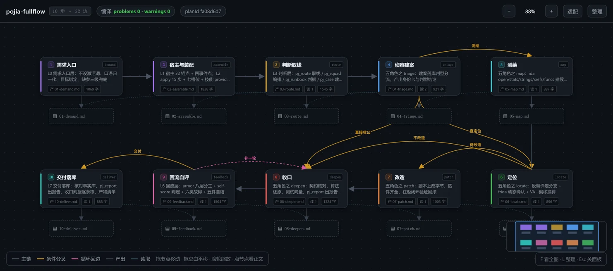
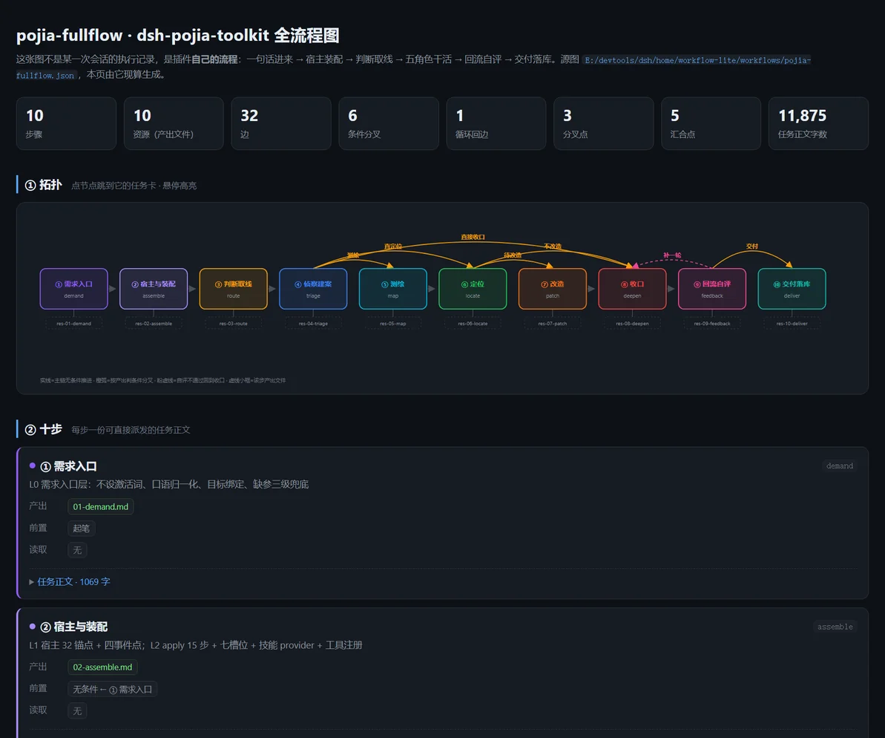

# dsh-workflows

**工作流仓库 —— 现成的 `.wflite.zip` 工作流合集**

由 [MingLin](https://github.com/Minglink) 维护

---

这里存放配合 **[dsh-jailbreak-workflow](https://github.com/Minglink/dsh-jailbreak-workflow)** 插件使用的现成工作流包（`.wflite.zip`），下载后导入插件即可直接运行。破甲制作是第一个上架的工作流，pojia-fullflow 是第二个，后续持续补充其他主题。

> [!TIP]
> 还没装插件？去 [dsh-jailbreak-workflow](https://github.com/Minglink/dsh-jailbreak-workflow) 看安装方法——网页版一条命令装好。

## 📋 工作流列表

| 工作流 | 说明 | 下载 |
|---|---|---|
| **破甲制作** | LLM 破甲研究自动化流水线，15 步，内置 `jailbreak-research` Skill（10 个测试脚本 + 4 套提示词模板） | [破甲制作.wflite.zip](./workflows/破甲制作.wflite.zip) |
| **pojia-fullflow** | 破甲逆向全流程，10 步 32 边，覆盖 27 条工作流 / 167 个阶段；**依赖本地 `dsh-pojia-toolkit` 插件提供的 `pj_*` 工具** | [pojia-fullflow.wflite.zip](./workflows/pojia-fullflow.wflite.zip) |

## 🖼️ pojia-fullflow

针对二进制 / 移动端 / 协议 / 加密等逆向目标的完整工作流，把「一句话需求」推到「可交付结论」：**需求入口 → 宿主与装配 → 判断取线 → 五角色干活 → 回流自评 → 交付落库**，10 个步骤、32 条边（6 条主链 / 6 条条件分叉 / 1 条循环回边 / 10 写 / 9 读），编译 `problems 0 · warnings 0`。

10 个步骤：

1. **需求入口**（`demand`）—— 口语归一化成「对象 / 动作 / 产出物」，目标绑定，缺参三级兜底（合理默认值 → 占位符 → 假设标注）
2. **宿主与装配**（`assemble`）—— 宿主 32 条 SECTION_ORDER、四事件点、15 步 apply 装配、七槽位、技能 provider、工具注册
3. **判断取线**（`route`）—— `pj_route` 取线 / `pj_squad` 编排 / `pj_runbook` 判据 / `pj_case` 建案
4. **侦察建案**（`triage`）—— 建案、落库、判型分流、产出身份卡与判型结论
5. **测绘**（`map`）—— ida open / stats / strings / xrefs / funcs，建候选表
6. **定位**（`locate`）—— 反编译定分支 + frida 动态确认 + VA→偏移换算
7. **改造**（`patch`）—— 副本上改字节、四件齐全、往返闭环验证回滚
8. **收口**（`deepen`）—— 契约核对、算法还原、测试向量、`pj_report` 出报告
9. **回流自评**（`feedback`）—— armor 八层分工 + self-score 判定 + 六类故障 + 五件套结构锁
10. **交付落库**（`deliver`）—— 核对事实库、`pj_report` 出报告、收口判据逐条核、产物清单

分叉点三处：`triage` 后按「测绘 / 直定位 / 直接收口」三分；`locate` 后按「待改造 / 不改造」二分；`feedback` 后按「补一轮 / 交付」二分（`补一轮` 是唯一的循环回边，回到 `deepen`）。

<table>
  <tr>
    <td></td>
  </tr>
</table>

### ⚠️ 前置依赖

本工作流的每步都要调 **`dsh-pojia-toolkit`** 插件提供的 `pj_*` 工具（`pj_route` `pj_squad` `pj_runbook` `pj_case` `pj_sample` `pj_facts` `pj_engine` `pj_decompile` `pj_va2off` `pj_patch` `pj_aob` `pj_crypto` `pj_decode` `pj_keygen` `pj_scan` `pj_bindiff` `pj_report` `pj_skills` `pj_profile` `pj_selftest`）。**没装这个插件，图画得出来但一步都跑不动。**

它目前是本机插件（尚未发布到 npm / GitHub），装法是在 DeepSeek Harness 的插件目录里挂上 `dsh-pojia-toolkit` 这个包，然后用 `pj_selftest` 自检确认「破甲工具包自检：全部就绪」再导入本工作流。

该插件还要求宿主具备 IDA Pro（`idalib`）与 Frida，`pj_decompile` / `pj_engine` / `pj_record` 那几个步骤才有真东西可跑；只用 `pj_route` / `pj_facts` / `pj_report` 这类纯逻辑步骤则不需要引擎。

如果你想跑的是纯提示词版（不依赖任何插件），可以按 `pojia-fullflow` 的 10 步结构自己拖一张，把每步的任务正文当提示词用——画布上的每一步都是自足的文本。

## 📥 导入方法

1. 点击上方表格的下载链接，把 `.wflite.zip` 保存到本机
2. 打开 DeepSeek Harness，进入插件的「工作流中心」
3. 选择「导入」，选中下载的 zip 包，确认资源放置位置
4. 导入完成后画布上即可看到完整流程，按需填写执行前提问（目标模型、API key 等），点击「执行」

## 🔗 相关项目

- **[dsh-jailbreak-workflow](https://github.com/Minglink/dsh-jailbreak-workflow)** —— 画布 → 计划提示词 → 模型执行的软工作流插件
- **[DeepSeek Harness](https://github.com/deepseek-ai/deepseek-harness)** —— 宿主应用

## 许可

[MIT](./LICENSE) © MingLin
