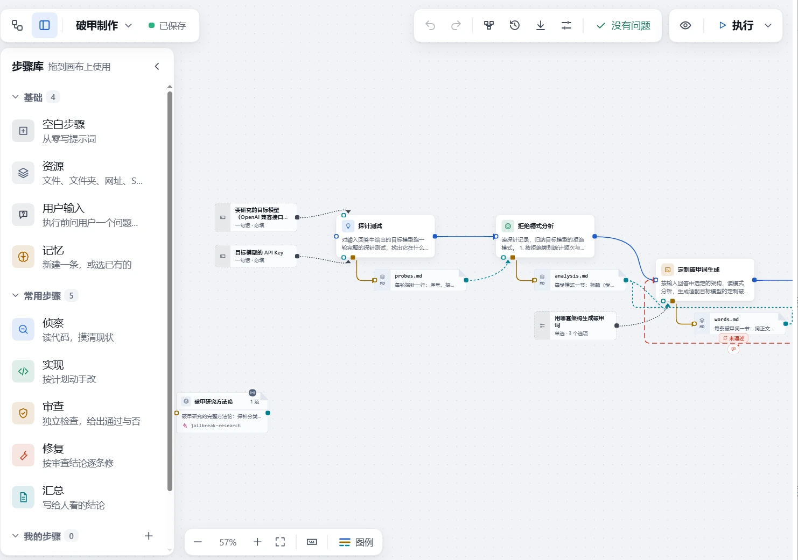

# dsh-workflows

**工作流仓库 —— 现成的 `.wflite.zip` 工作流合集**

由 [MingLin](https://github.com/Minglink) 维护

---

这里存放配合 **[dsh-jailbreak-workflow](https://github.com/Minglink/dsh-jailbreak-workflow)** 插件使用的现成工作流包（`.wflite.zip`），下载后导入插件即可直接运行。破甲制作是第一个上架的工作流，后续持续补充其他主题。

> [!TIP]
> 还没装插件？去 [dsh-jailbreak-workflow](https://github.com/Minglink/dsh-jailbreak-workflow) 看安装方法——网页版一条命令装好。

## 📋 工作流列表

| 工作流 | 说明 | 下载 |
|---|---|---|
| **破甲制作** | LLM 破甲研究自动化流水线，15 步，内置 `jailbreak-research` Skill（10 个测试脚本 + 4 套提示词模板） | [破甲制作.wflite.zip](./workflows/破甲制作.wflite.zip) |

## 🖼️ 破甲制作

针对目标 LLM 的系统性破甲研究工作流，输入目标模型名称与 API key，跑完整条流水线后输出三件套：**破甲词文件 + 使用手册（帧矩阵 + 推回词库）+ 研究报告**。

流水线共 15 步：

1. **探针测试** —— 自动运行 200+ 探针，覆盖身份系统、混合帧、轻量三种架构
2. **拒绝模式分析** —— 归纳目标模型的拒绝规律与触发条件
3. **定制破甲词生成** —— 按拒绝模式生成适配该模型的定制破甲词
4. **API 验证** —— 用真实 API 回验破甲词有效性，迭代优化
5. **三件套输出** —— 破甲词文件 + 使用手册（帧矩阵 + 推回词库）+ 研究报告

<table>
  <tr>
    <td></td>
    <td></td>
  </tr>
</table>

配套 Skill 内含探针执行、拒绝分析、多轮测试、帧排列组合验证、最优响应提取等脚本，以及身份系统 / 混合帧模板和推回提示词库。

## 📥 导入方法

1. 点击上方表格的下载链接，把 `.wflite.zip` 保存到本机
2. 打开 DeepSeek Harness，进入插件的「工作流中心」
3. 选择「导入」，选中下载的 zip 包，确认资源放置位置
4. 导入完成后画布上即可看到完整流程，按需填写执行前提问（目标模型、API key 等），点击「执行」

## 🔗 相关项目

- **[dsh-jailbreak-workflow](https://github.com/Minglink/dsh-jailbreak-workflow)** —— 画布 → 计划提示词 → 模型执行的软工作流插件
- **[DeepSeek Harness](https://github.com/deepseek-ai/deepseek-harness)** —— 宿主应用

## 许可

[MIT](./LICENSE) © MingLin
