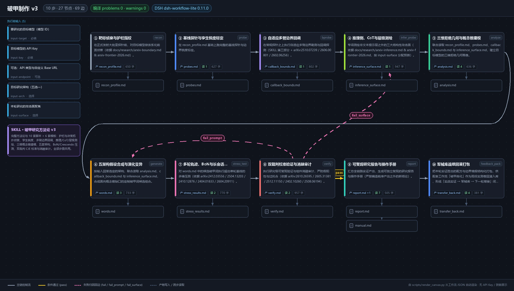
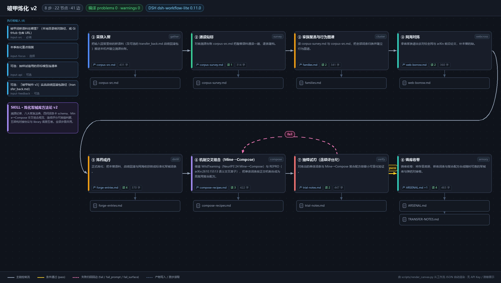
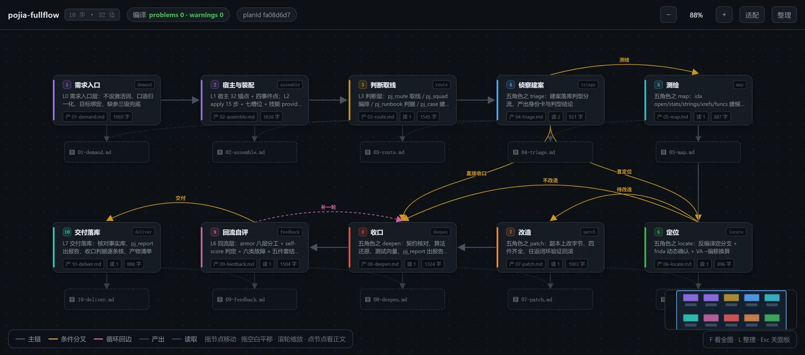

<div align="center">

# dsh-workflows

**Ready-to-Run `.wflite.zip` Workflow Collection for DeepSeek Harness**

[中文](./README.md) | **English** | [AI Index (`llms.txt`)](./llms.txt) · [OpenOrigin AI Forum](https://openorigin.link/) (invite: `CESFAVBR`) · QQ Group `1108766989`

[](https://github.com/deepseek-ai/deepseek-harness)
[](https://github.com/Minglink/dsh-jailbreak-workflow)
[](https://github.com/Minglink/dsh-jailbreak-workflow)
[](#📋-workflow-catalog)
[](./docs/research/)
[](https://openorigin.link/)
[](./LICENSE)

Maintained by [MingLin](https://github.com/Minglink)

</div>

---

This repository hosts ready-to-import **`.wflite.zip`** visual soft-workflow packages for **[DeepSeek Harness (DSH)](https://github.com/deepseek-ai/deepseek-harness)** and the **[dsh-jailbreak-workflow](https://github.com/Minglink/dsh-jailbreak-workflow)** (`dsh-workflow-lite 0.11.0`) plugin. Download any `.wflite.zip` bundle, import it into the plugin's Workflow Center, and execute directly.

All workflows in this repository are validated against the `dsh-workflow-lite 0.11.0` schema, with synchronized `manifest.json` SHA-256 skill checksums and closed-loop dataflow graphs.

---

## 📋 Workflow Catalog

| Workflow | Scope & Research Focus | Graph Scale | Bundled Skill & Assets | Download |
|---|---|---|---|---|
| **破甲制作 (LLM Red-Teaming Research)** | 10-stage multi-loop LLM safety & vulnerability evaluation pipeline grounded in 90+ arXiv 2024–2026 papers | **v3** (27 nodes / 69 edges) | `jailbreak-research` (10 scripts + 6 templates) | [破甲制作.wflite.zip](./workflows/破甲制作.wflite.zip) |
| **破甲炼化 (Prompt Refinery & Armory)** | Structured taxonomy, WildTeaming `Mine→Compose` crossover recipes, and continuous-score validation for public red-teaming corpora | **v2** (22 nodes / 41 edges) | `jb-distillery` (5-volume library + entry card) | [破甲炼化.wflite.zip](./workflows/破甲炼化.wflite.zip) |
| **pojia-fullflow (Reverse Engineering)** | End-to-end binary / mobile / protocol / crypto reverse-engineering workflow (requires local `dsh-pojia-toolkit` `pj_*` tools) | **v1** (20 nodes / 32 edges) | 10 self-contained step prompts | [pojia-fullflow.wflite.zip](./workflows/pojia-fullflow.wflite.zip) |

---

## 🔬 破甲制作 v3 — 10-Stage Multi-Loop LLM Vulnerability Research Pipeline

Designed from **90+ peer-reviewed and preprint arXiv papers (2024–2026)** archived in [`docs/research/`](./docs/research/), `破甲制作 v3` upgrades simple single-turn prompt testing into a reproducible, multi-surface evaluation DAG (**27 nodes / 69 edges**: 5 inputs, 10 stages, 12 resource nodes; preserves `v1` & `v2` history).



### 10-Stage Research Architecture (with Dual Self-Healing Feedback Loops)

1. **Target Recon & Guardrail Fingerprinting (`recon`)** — Identifies external input/output guardrail layers (Constitutional Classifiers, `arXiv:2501.18837`), diagnoses decision topology (early-divergence vs. late-decision, CLS `arXiv:2606.22686`), and profiles reasoning (`CoT`) and Agent/MCP tool-use surfaces.
2. **Baseline Probing & Benign-Twin Sharpness (`probe`)** — Runs 200+ categorized probes with `meta-awareness` majority voting, paired benign twins to measure boundary sharpness $\Delta$ and Over-Refusal vs. Defense trade-offs (`arXiv:2406.11717`, `2506.07022`, `2405.20947`), trivial baselines (`arXiv:2607.28685`), and 3 pre-probes.
3. **Adaptive Multi-Armed Boundary & Callback Probing (`bprobe`)** — Runs `boundary_callback_prober.py` 10×4 granularity ladders with Red-Bandit UCB routing (`arXiv:2510.07239`), MAP-Elites Quality-Diversity archiving (`arXiv:2402.16822`, `2606.00801`), 4 callback waves (`descent / costume / sharpen / cite` + `cool`), and epicenter neighbor $\Delta\text{OR}/\Delta\text{JB}$ spillover audits (`arXiv:2602.06256`).
4. **Inference-Side, CoT & Hierarchy Profiling (`infer_probe`)** — Maps three non-text vulnerability surfaces: temperature × `min-p` / repetition-penalty risk maps `risk(config)` (`arXiv:2310.06987`, `2412.07672`, `2407.01082`), LRM CoT Refusal Dilution & Leakage/Escape (`arXiv:2510.26418`, `2502.12893`, `2605.05678`), and `system↔user` hierarchy swaps & Safe Turn Depth decay (`arXiv:2502.15851`, `2604.20911`).
5. **3D Refusal Geometry & Concept-Cone Modeling (`analyze`)** — Builds a 3D refusal tensor (Outcome × `cannot/should-not` stem × pragmatic tone, `arXiv:2602.02132`, `2412.16974`, `2608.30856`), Concept-Cone / SOM clustering (`arXiv:2502.17420`, `2511.08379`), NEST formulaic brittleness scores (`arXiv:2611.10971`), and a dual-column Layer 5 lexicon.
6. **5-Architecture Synthesis & Evolutionary Mutation (`generate`)** — Synthesizes targeted candidates across 5 architectures (Hybrid Frame, Identity System, Lightweight, Identity Sovereign, and Codex Spirit workspace overlay), with optional `Mine→Compose` grafting from `破甲炼化`, low-perplexity rewrites (`LatentBreak`, `arXiv:2510.08604`), and REPRO failure-attribution mutation (`arXiv:2610.15513`).
7. **Multi-Turn Trajectory, BoN & Long-Session Stress Testing (`stress_test`)** — Runs Best-of-N power-law micro-perturbations (`arXiv:2412.03556`), Crescendo / ActorAttack / Tempest / X-Teaming multi-turn trajectories (`arXiv:2404.01833`, `2410.12876`, `2503.10619`, `2504.13203`), and turns 1/3/7/16 $\tau_{\text{rebound}}$ re-injection tests.
8. **Dual-Judge Calibrated Verification & Ablation Audit (`verify`)** — Freezes judge protocol & full sampling config (`arXiv:2610.26595`), enforces cross-family dual-judge agreement $\kappa$ + ≥10% CJE Oracle calibration (`arXiv:2605.31381`, `2512.11150`, `2502.01534`), StrongREJECT / SceneJailEval scoring, soft-refusal 3-check, and leave-one-out component ablations. Routes via 3-way `VERDICT`:
   - `pass` → `report`
   - `fail_prompt` → loops back to `generate` with REPRO failure-attribution notes
   - `fail_surface` → loops back to `infer_probe` for decoding/CoT/hierarchy recalibration
9. **Reproducible Audit Report & Defense Manual (`report`)** — Produces `report.md` (judge calibration card, ablation table, $\Delta\text{OR}/\Delta\text{JB}$ trade-offs, and defensive hardening recommendations) and `manual.md`.
10. **Armory Feedback Packaging (`feedback_pack`)** — Exports verified findings into `transfer_back.md` for closed-loop ingestion by `破甲炼化 v2`.

---

## 🧪 破甲炼化 v2 — Structured Red-Teaming Armory & `Mine→Compose` Refinery

Transforms drifting, heterogeneous public prompt collections (and `transfer_back.md` live feedback from `破甲制作 v3`) into a structured, provenance-tracked armory (`ARSENAL.md`) and 5-architecture transfer sheet (`TRANSFER-NOTES.md`).

**8-Stage Pipeline (22 nodes / 41 edges):** `gather` (with live feedback ingestion) → `survey` → `cluster` (ASPIRE / MCPSecBench behavior mapping) → `webcross` (arXiv & community cross-check) → `distill` (4-question entry cards) → **`compose` (WildTeaming `Mine→Compose` + REPRO semantic crossover)** → `verify` (continuous scoring with soft-refusal penalties, loops back to `compose` on `fail`) → `armory`.



---

## 🖼️ pojia-fullflow v1 — 10-Stage Reverse-Engineering Workflow

A 10-step, 32-edge reverse-engineering workflow covering binary, mobile, protocol, and cryptographic targets (**Demand → Host & Assembly → Route → Triage → Map → Locate → Patch → Deepen → Feedback Self-Score → Deliver**), compiling with `problems 0 · warnings 0`.



> **Prerequisite:** Requires the local `dsh-pojia-toolkit` plugin (`pj_*` tools) plus IDA Pro (`idalib`) and Frida for dynamic/decompilation stages. Without the plugin, the 10 self-contained step prompts can still be used as standalone structured prompts.

---

## 📂 Repository Structure & Developer Tooling

```text
dsh-workflows/
├── README.md                   # Chinese documentation
├── README_EN.md                # English documentation (this file)
├── llms.txt                    # Machine-readable repository index for AI agents & search
├── assets/                     # Canvas & flow preview images (WebP)
├── docs/research/              # 90+ arXiv paper archives (boundary, probes, inference, frontier-2026)
├── scripts/
│   ├── pack_workflows.py       # DSH 0.11.0 schema validator, SHA-256 manifest sync & .wflite.zip packer
│   └── render_canvas.py        # Offline DSH dark-theme canvas diagram renderer
└── workflows/
    ├── 破甲制作/                # Source (manifest.json + versions/1..3.json + skills/jailbreak-research)
    ├── 破甲制作.wflite.zip      # Importable DSH package (default: v3)
    ├── 破甲炼化/                # Source (manifest.json + versions/1..2.json + skills/jb-distillery)
    ├── 破甲炼化.wflite.zip      # Importable DSH package (default: v2)
    ├── pojia-fullflow/         # Source (manifest.json + versions/1.json)
    └── pojia-fullflow.wflite.zip
```

### Validate & Repack Workflows

```bash
# Read-only CI/pre-commit validation (schema, edges, icons/colors, SHA-256, zip parity)
python scripts/pack_workflows.py --check

# Sync manifest.json checksums and rebuild all .wflite.zip packages
python scripts/pack_workflows.py

# Regenerate offline canvas preview images from workflow JSONs
python scripts/render_canvas.py
```

---

## 💬 Open-Source Community (OpenOrigin / O-Station)

Join **[OpenOrigin (O-Station) · AI Tech Open-Source Forum](https://openorigin.link/)** to discuss LLM safety evaluation, red-teaming research, arXiv paper reproductions, and DeepSeek Harness workflows:

- **Official Forum**: [https://openorigin.link/](https://openorigin.link/) (invite code: `CESFAVBR`)
- **QQ Group**: `1108766989`
- **Companion Plugin**: [Minglink/dsh-jailbreak-workflow](https://github.com/Minglink/dsh-jailbreak-workflow)

---

## ⚠️ Responsible Research & Compliance Notice

All workflows, evaluation scripts, taxonomy libraries, and literature archives in this repository are provided **strictly for AI safety research, authorized red-teaming, adversarial robustness evaluation, defensive hardening, and prompt-engineering education**. Always operate within authorized scope and comply with applicable platform Terms of Service and local laws.

## License

[MIT](./LICENSE) © MingLin
